  

<h1 align="center">👋 Hi, I’m @TempGaurab</h1>

  NLP · LLM &amp; gene–disease interpretability · building at <a href="https://github.com/Nyvora-Vision-Labs">Nyvora Vision Labs</a>

---

Welcome to my GitHub!

## 💡 About Me

- I primarily work in **NLP**.
- I'm always exploring new ideas to build, research, and experiment with.
- My old account is gone for good, but the work continues stronger than ever 🚀

## 🛠️ What I’m Currently Working On

- **LLM and gene–disease interpretability**
- Random projects at **[Nyvora Vision Labs](https://github.com/Nyvora-Vision-Labs)** — do check it out!

## 🤝 Let's Talk

If you’re interested in collaborating or just want to talk research/ideas, feel free to reach out!

ASCII portrait made with <a href="https://nyvora-vision-labs.github.io/FaceToREADME/">FaceToREADME</a>

